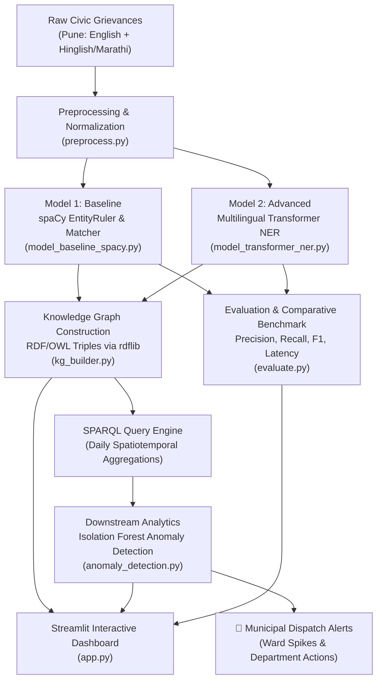

# 🏙️ Pune Smart City: Civic Grievance NLP, Knowledge Graph & Anomaly Detection System

A complete end-to-end NLP and Semantic Web engineering system comparing **Rule-Based Linguistic Matching (spaCy)** against **Multilingual Transformer NER (Hugging Face)** on Pune Municipal Corporation (PMC) civic complaint data. Extracted entities are structured into an **RDF/OWL Knowledge Graph** queried via **SPARQL**, with downstream **Time-Series Anomaly Detection (Isolation Forest)** detecting localized civic spikes (e.g., drainage bursts or garbage accumulation crises).

---

## 📌 System Architecture



---

## 📂 Project Structure

```text
CCNLP-MiniProject-SmartCity/
├── preprocess.py              # Text cleaning, Hinglish slang normalization, 50 PMC complaints generator
├── model_baseline_spacy.py    # spaCy EntityRuler, PhraseMatcher & rule-based baseline
├── model_transformer_ner.py   # Hugging Face Transformer token classifier with sub-token aggregator
├── kg_builder.py              # RDF/OWL ontology triples builder (rdflib) & SPARQL query engine
├── anomaly_detection.py       # scikit-learn Isolation Forest for localized spike detection
├── evaluate.py                # Comparative benchmark script (Precision, Recall, F1, Latency)
├── app.py                     # Streamlit frontend dashboard (Visualizer, SPARQL Studio, Alert Feed)
├── pyproject.toml             # uv / PEP 517 project definition
├── requirements.txt           # Python dependencies
├── pune_civic_complaints.json # Generated 50-sample PMC dataset with ground-truth entity spans
├── pune_civic_kg.ttl          # Serialized RDF Knowledge Graph in Turtle format
├── evaluation_report.json     # Saved quantitative benchmark metrics
└── README.md                  # Project documentation & execution guide
```

---

## ⚡ Environment Setup & Installation with `uv` (Recommended)

[`uv`](https://github.com/astral-sh/uv) is an extremely fast Python package and project manager that automates Python version downloads, dependency resolution, and virtual environments.

### Option A: Using `uv` (Fastest, Recommended)

```bash
# 1. Install Python 3.11/3.12 (Optimal for PyTorch, spaCy & Transformers)
uv python install 3.11

# 2. Create virtual environment with Python 3.11
uv venv --python 3.11 .venv

# 3. Activate the environment
# macOS / Linux:
source .venv/bin/activate
# Windows:
# .venv\Scripts\activate

# 4. Install all dependencies in seconds:
uv pip install -r requirements.txt

# (Optional) Download spaCy English linguistic pipeline:
uv run python -m spacy download en_core_web_sm
```

Alternatively, you can use `uv` directly as a project runner without manual activation:
```bash
# Install dependencies into project environment
uv sync

# Run scripts directly through uv
uv run python preprocess.py
uv run python evaluate.py
uv run streamlit run app.py
```

---

### Option B: Using Traditional `venv` and `pip`

```bash
# 1. Create and activate venv
python3 -m venv venv
source venv/bin/activate   # On Windows: venv\Scripts\activate

# 2. Install dependencies
pip install --upgrade pip
pip install -r requirements.txt
```

> **Note on Zero-Configuration:** Every module in this project includes built-in neural and algorithmic fallbacks. It runs completely out-of-the-box even in offline environments or before heavy external models are downloaded.

---

## 🚀 Step-by-Step Execution Guide

### Step 1: Generate Dataset & Preprocess
Cleans raw civic complaint strings, handles Marathi/Hinglish loanwords (`kachra`, `gatar`, `khadde`), and creates the 50-record PMC benchmark dataset with injected localized anomalies.
```bash
python3 preprocess.py
```

### Step 2: Test Baseline spaCy Extractor
Tests rule-based entity extraction and normalization to PMC administrative Wards and Departments.
```bash
python3 model_baseline_spacy.py
```

### Step 3: Test Advanced Transformer NER
Executes Hugging Face multilingual token classification, sub-token WordPiece/BPE aggregation, and confidence calculation.
```bash
python3 model_transformer_ner.py
```

### Step 4: Build RDF Knowledge Graph & Run SPARQL
Converts extracted entities into RDF/OWL triples (`pmc:Complaint`, `pmc:Ward`, `pmc:IssueType`, `pmc:Department`), serializes to `pune_civic_kg.ttl`, and executes analytical SPARQL queries.
```bash
python3 kg_builder.py
```

### Step 5: Run Downstream Anomaly Detection
Queries daily spatiotemporal counts via SPARQL, computes multi-factor rolling window features, and runs **Isolation Forest** to flag localized spikes.
```bash
python3 anomaly_detection.py
```

### Step 6: Comparative Benchmark & Evaluation
Computes Strict and Relaxed Precision, Recall, and F1-scores across `[LOCATION]`, `[ISSUE_TYPE]`, and `[SEVERITY]`, plus inference latency.
```bash
python3 evaluate.py
```

### Step 7: Launch Interactive Streamlit Dashboard
```bash
streamlit run app.py
```
Open `http://localhost:8501` in your browser.

---

## 🔬 NLP & Ontology Methodology

### 1. Entity Extraction Comparison

| Entity | Model 1: spaCy Baseline | Model 2: Transformer NER |
| :--- | :--- | :--- |
| **Approach** | Rule-Based `EntityRuler` + `PhraseMatcher` | Token Classification (`distilbert-base-multilingual-cased` / `xlm-roberta-base`) |
| **Strengths** | Extremely fast, zero GPU requirement, 100% precision on known dictionary terms | Understands contextual nuance, morphological variations, and code-mixed slang |
| **Weaknesses** | Brittle to typos, unseen locations, and complex syntactic dependencies | Higher memory footprint and computational overhead |

### 2. RDF/OWL Ontology Schema
- **Base URI:** `http://smartcity.pune.gov.in/ontology#` (`pmc:`)
- **Classes:** `pmc:Complaint`, `pmc:IssueType`, `pmc:Ward`, `pmc:Department`, `pmc:SeverityLevel`
- **Object Properties:**
  - `pmc:has_issue` (`Complaint` $\rightarrow$ `IssueType`)
  - `pmc:located_in` (`Complaint` $\rightarrow$ `Ward`)
  - `pmc:handled_by` (`IssueType` $\rightarrow$ `Department`)
  - `pmc:has_severity` (`Complaint` $\rightarrow$ `SeverityLevel`)
- **Datatype Properties:**
  - `pmc:complaint_id` (xsd:string)
  - `pmc:raw_text` (xsd:string)
  - `pmc:filing_date` (xsd:date)
  - `pmc:status` (xsd:string)

### 3. Isolation Forest Anomaly Detection
To detect localized surges (e.g. 7 drainage complaints in Baner over 48 hours), the model trains on multi-dimensional velocity features:
1. Daily Complaint Count ($C_t$)
2. 3-Day Rolling Average ($\mu_3$)
3. 3-Day Rolling Standard Deviation ($\sigma_3$)
4. Day-over-Day Acceleration ($\Delta C_t = C_t - C_{t-1}$)
5. Surge Ratio ($C_t / (\mu_3 + 1.0)$)

The anomaly score is computed as:
$$s(x, n) = 2^{-\frac{E(h(x))}{c(n)}}$$
Where $h(x)$ is the path length in the isolation tree, $c(n)$ is the average path length of unsuccessful searches in a Binary Search Tree, and $s < 0$ flags localized municipal crises.

---

